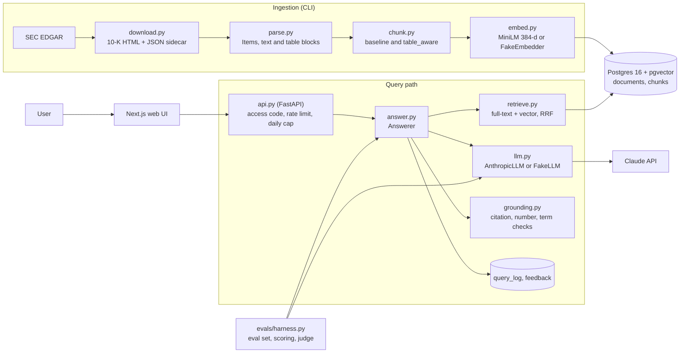
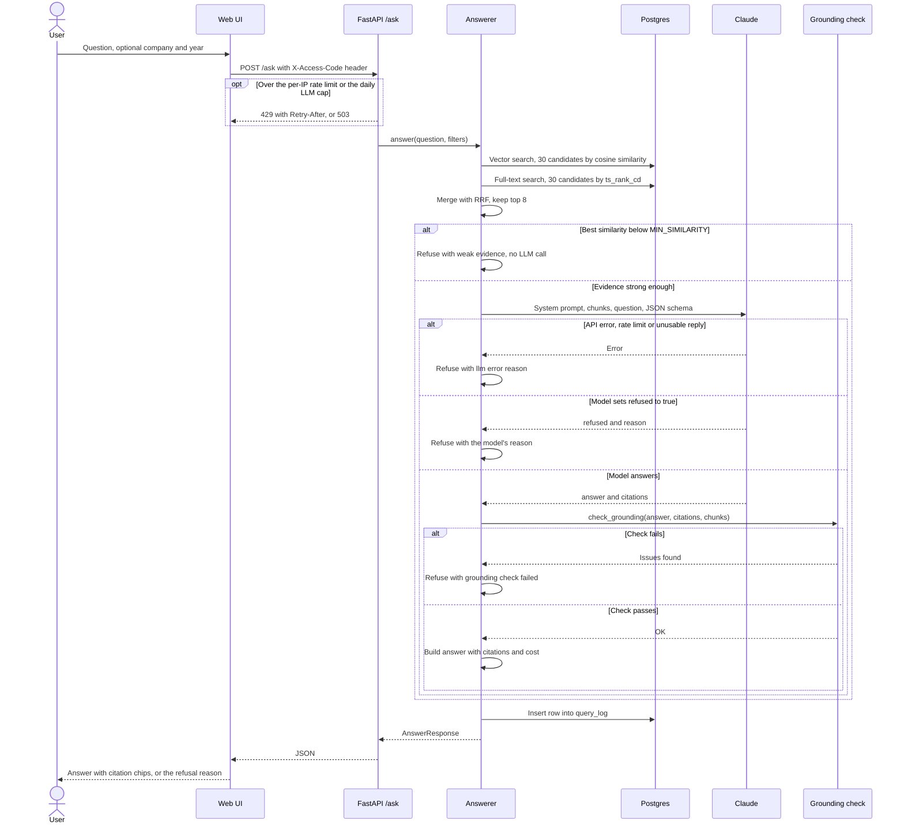
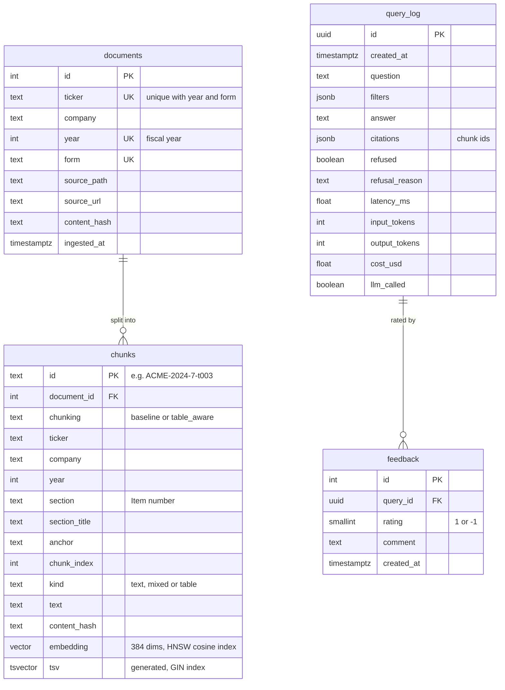

# doc-copilot

A question-answering copilot over SEC 10-K filings that answers only from the documents, cites the exact passages it used, and says "I don't know" when the filings don't support an answer.

[](https://github.com/byteKumar/doc-copilot/actions/workflows/ci.yml)

**Status:** the code is built and tested: ingestion, hybrid retrieval, grounded answering, the eval harness, the chat UI, CI and deployment config. It has only run on a small synthetic fixture corpus with an offline stand-in for the LLM. **Not done yet:** downloading real filings, writing the eval set, any run against Claude, the deployed URL and the demo video. Every result number in [RESULTS.md](RESULTS.md) stays blank until it is measured.

By Chaman Kumar (MS Computer Science, Northeastern University, graduating December 2026).

---

## At a glance

- **What it does:** answers questions about companies' annual reports (10-Ks) with clickable citations to the source passage, and refuses when the evidence isn't there.
- **The customer problem:** analysts need specific facts from 100-page filings, and a general chatbot can't show where an answer came from and sometimes invents numbers.
- **Stack:** Python 3.12, FastAPI, Postgres 16 with pgvector, local sentence-transformers embeddings (all-MiniLM-L6-v2), Claude with JSON-schema structured output, Next.js 16 with TypeScript, pytest, Docker, GitHub Actions.
- **Production-minded parts:** a deterministic grounding check on every answer, three refusal paths, an eval harness (accuracy, citation accuracy, refusal rates, p50/p95 latency, cost per 1,000 queries), cost tracking per query, a daily cap on LLM calls, an access code, rate limiting, and CI with lint, 72 tests against real Postgres and a web build.
- **Current status:** the pipeline works end to end offline. Real-data results are not measured yet.

## The problem

A team (say, analysts at an investment firm or a corporate strategy group) needs reliable answers from long documents. A 10-K runs 80 to 150 pages, much of it tables. Typical questions: "What was segment X's revenue in fiscal 2024?", "What does the company say about supplier risk?", "Did net income go up or down?"

A plain chatbot fails this team in three ways:

1. **It makes things up.** It answers fluently even when it has never seen the number. In financial work a wrong number is worse than no answer.
2. **It shows no sources.** The analyst can't check the answer without redoing the search by hand.
3. **It never says "I don't know".** A question about a year that isn't loaded, or a fact that 10-Ks don't contain, still gets a confident answer.

doc-copilot handles each one: it only uses retrieved passages, every answer carries citations that open the source text, and it refuses when retrieval is weak, when the model says the passages don't contain the answer, or when an automatic check finds the answer isn't supported by what it cites.

## Why I built this

A Forward Deployed Engineer works with a customer's real data and real constraints and ships something that works for them: they take messy inputs, build a working system on top, prove it works with measurements, deploy it, and explain the results in the customer's terms.

This project practices those parts of the job:

| FDE task | Where it shows up here |
|---|---|
| Handle messy customer data | Parsing real EDGAR HTML: nested markup, a table of contents that repeats every heading, `$` and `%` in their own table cells (`ingest/parse.py`) |
| Make the output trustworthy | Citations, refusals and a grounding check (`answer.py`, `grounding.py`) |
| Prove it works | An eval harness with metrics a customer cares about, plus a human check of the LLM judge (`evals/`) |
| Improve from evidence | A second chunking strategy for tables, stored side by side so one eval run compares both (`ingest/chunk.py`, `eval run --compare`) |
| Control cost and access | Per-query cost logging, a daily cap, a dry-run cost estimate, an access code and rate limit (`api.py`, `evals/harness.py`) |
| Ship it | Dockerfiles, a Render blueprint, CI (`Dockerfile`, `render.yaml`, `.github/workflows/ci.yml`, [DEPLOY.md](DEPLOY.md)) |
| Explain it to the customer | A one-page client brief ([CUSTOMER_BRIEF.md](CUSTOMER_BRIEF.md)) |

## Demo

**Coming soon.** A 3-minute demo video and screenshots of the chat UI and usage page will go here once the app runs on real filings and is deployed.

- Demo video: coming soon
- Live demo: coming soon
- Screenshots: coming soon

## Architecture

Ingestion runs from the command line and fills Postgres. The API answers questions from what is stored there. The eval harness calls the same answer service the API uses, so eval numbers describe the real code path.



More detail, module by module: [docs/ARCHITECTURE.md](docs/ARCHITECTURE.md).

## How a question is answered

One request to `POST /ask`, end to end. Every path ends with a row in `query_log`, including refusals.



## System design

### Data model

Four tables, created by `src/doc_copilot/db.py` (`schema_sql`). Both chunking strategies live in the same `chunks` table, told apart by the `chunking` column.



Indexes: GIN on `chunks.tsv`, HNSW on `chunks.embedding` (`vector_cosine_ops`), a B-tree on `(chunking, ticker, year)` for filters, and one on `query_log.created_at` for the daily cap and usage stats.

### Ingestion and chunking

1. **Download** (`ingest/download.py`). Looks up each ticker's CIK, lists its 10-K filings from the EDGAR submissions API, and picks the one whose `reportDate` falls in the requested fiscal year. Amendments (10-K/A) are skipped. It refuses to run without a real `SEC_USER_AGENT` (SEC requires a name and contact) and waits 0.15 s between requests. Each filing is saved as `TICKER_YEAR_10-K.html` with a `.json` sidecar holding company name, year and source URL.
2. **Parse** (`ingest/parse.py`). Drops scripts, hidden elements and the inline XBRL header, then walks the HTML in order and emits text blocks and table blocks. A short block that matches "Item 1A. Risk Factors" starts a new section. The table of contents repeats every heading, so for each Item the occurrence with the most words wins. Table cells that hold only `$`, `%` or `)` are merged with their neighbours, and up to three leading rows with no numeric data (year labels don't count as data) are marked as column headers.
3. **Chunk** (`ingest/chunk.py`). Two strategies, both stored:
   - `baseline`: each section becomes one stream of words cut into windows of 220 words with a 40-word overlap. A table can be split, and the second half loses its "2024 | 2023" header row.
   - `table_aware`: prose is windowed the same way but never across a table. Each table becomes its own chunk (split by rows if large), and every table chunk repeats the caption line before it and the table's header rows.
   Chunk ids are stable: `{TICKER}-{YEAR}-{ITEM}-{b|t}{index:03d}`.
4. **Embed and store** (`ingest/pipeline.py`). Each chunk is embedded with a header ("Company (TICKER) YEAR 10-K. Section title.") so a chunk that never names the company can still match. Re-ingest is idempotent: a file hash (which includes the chunk size settings) decides whether to re-parse, a per-chunk hash decides whether to re-embed, and chunk ids that disappeared are deleted. Each file is ingested in one transaction.

### Hybrid retrieval and RRF

`retrieve.py` runs two searches for every question, both limited by the optional company and year filters:

- **Full-text search**: Postgres `tsvector` ranked by `ts_rank_cd`. The question's words are joined with OR, because a natural question rarely contains every word of its answer. Good at exact terms like "Item 1A", a segment name or "backlog".
- **Vector search**: cosine similarity between the question's embedding and each chunk's embedding (pgvector, HNSW index). Good at paraphrase: "how many people work there" finds "full-time employees".

Each returns 30 candidates. The two scores are on different scales, so adding them would be meaningless. **Reciprocal rank fusion (RRF)** uses only the rank:

```
rrf(chunk) = sum over both lists of 1 / (60 + rank of the chunk in that list)
```

A chunk ranked 1st in one list only scores 1/61 = 0.0164. A chunk ranked 3rd in both lists scores 2/63 = 0.0317 and wins. Agreement between the two methods beats a single strong vote. The top 8 by RRF score go to the model. k = 60 is the default from the original RRF paper and has not been tuned here.

### The grounding check

`grounding.py` runs after the model answers. It costs nothing (no second LLM call) and is deterministic. An answer is rejected if:

1. it has no citations, or cites a chunk id that was not among the retrieved chunks;
2. a non-trivial number in the answer does not appear in the cited chunks (or in the question). Unit scale and rounding are allowed: "$1.6 billion" matches a table cell "1,587.1" in a table stated in millions. Years (1990 to 2035) and whole numbers under 10 are skipped;
3. fewer than 40% of the answer's key words (4+ letters, minus stop words) appear in the cited chunks or the question.

It does not prove an answer is right or complete. It catches the expensive failure: a confident number with no source.

### Key design decisions

| Decision | Alternative considered | Trade-off |
|---|---|---|
| Postgres + pgvector for vectors, text and logs | A separate vector database | One system, SQL filters and transactions. Less specialised vector tuning at large scale. |
| Hybrid search (full-text + vector) | Vector search only | Catches exact terms that embeddings blur. Two queries per question. |
| RRF on ranks | Weighted sum of scores | Needs no score normalisation or weight tuning. Ignores how confident each retriever was. |
| OR of question words in full-text | `websearch_to_tsquery` (AND of words) | Better recall on natural questions. More loosely related lexical matches. |
| Local MiniLM embeddings (384-d) | A paid embedding API | Free and runs on CPU. Weaker on financial jargon, and torch needs about 1 GB of RAM in the API container. |
| JSON schema structured output | Free text with "[1]" markers | Citations are machine-checkable with no parsing. Depends on a provider feature. |
| Deterministic grounding check | A second LLM call to verify | Free and predictable. Rejects correct derived numbers (a computed growth rate not printed in the filing). |
| Similarity floor before the LLM | Always call the LLM | Off-topic questions cost nothing. The floor must be tuned, or it causes false refusals. |
| Both chunking strategies stored side by side | Re-ingest per experiment | One eval run compares both on identical questions. Twice the storage and embedding work. |
| `FakeLLM` and `FakeEmbedder` behind the same interfaces | Mocking the SDK in tests | Tests and CI never touch a paid API. The fakes say nothing about model quality. |
| In-memory rate limiter | Redis or a Postgres table | No extra infrastructure. Per process, resets on restart. |
| Shared access code | User accounts | Simple for a demo. Not acceptable for a customer. |

### Failure handling

- **LLM errors.** The Anthropic SDK client retries twice (`max_retries=2`). After that, a rate limit, a 5xx or 529, a connection error, a `refusal` or `max_tokens` stop reason, or invalid JSON each map to a typed error in `llm.py`. The answer service turns any of them into a refusal with the reason ("llm error: ..."), not a 500.
- **Rate limits on our side.** `/ask` returns 429 with `Retry-After` when one client IP sends more than `RATE_LIMIT_PER_MINUTE` (default 10) in any 60 seconds. It returns 503 once `DAILY_QUERY_CAP` (default 500) LLM calls have been made in the last 24 hours.
- **Weak evidence.** If nothing is retrieved or the best vector similarity is under `MIN_SIMILARITY` (0.25 with real embeddings, 0 with the fake embedder), the question is refused without calling the model.
- **Unsupported answers.** The grounding check rejects them; the model's original text is kept in `model_answer` for debugging.
- **Ingestion.** The downloader reports each failed ticker and year and keeps going. Each file is ingested in its own transaction, so a failure leaves no half-written document.
- **UI.** The access gate shows "API not reachable" with a retry button. A 429 shows a "wait a minute" message. Feedback is best effort.

### Security

- `ACCESS_CODE`: when set, every request except `/health` and CORS preflight must send it in the `X-Access-Code` header. It is compared in constant time (`hmac.compare_digest`). The UI asks for it once and keeps it in the browser's localStorage.
- Rate limit per client IP (taken from `X-Forwarded-For` when present) and a global daily cap on LLM calls.
- CORS allows only `CORS_ORIGINS` (default `http://localhost:3001`). 401 and 429 responses still carry CORS headers so the UI can show them.
- No secrets in the repo: `.env` is git-ignored, `.env.example` has empty values, and `render.yaml` marks keys `sync: false` so they are entered in the dashboard.
- All SQL is parameterised. The full-text query is built only from `[a-z0-9]` words. Request bodies are length-limited by Pydantic (question 3 to 1,000 characters).
- The API container runs as a non-root user.
- The test suite deletes every `ANTHROPIC_*` variable, and the paid client refuses to start inside tests.

### Cost control

- `LLM_PROVIDER` defaults to `fake` in code. Nothing paid runs unless it is set to `anthropic`.
- Weak-evidence refusals skip the LLM call entirely.
- Each answer's input and output tokens and dollar cost are stored in `query_log` and shown in the UI and on the `/usage` page (total cost, cost per 1,000 queries, LLM calls today against the cap).
- `DAILY_QUERY_CAP` bounds worst-case spend: cap times cost per query.
- `eval run --dry-run` builds the real prompts and prints projected tokens and dollars without calling the API. A paid eval run also needs `--yes`.
- Requests use `effort: "low"` and send at most `TOP_K` chunks (default 8).
- Prices come from `LLM_PRICE_INPUT_PER_MTOK` and `LLM_PRICE_OUTPUT_PER_MTOK`, so they can be updated without a code change.

### What changes at 10x and 100x scale

These are expectations, not measurements.

- **10x the corpus (hundreds of companies, several years).** One Postgres instance still holds it. CPU embedding during ingestion becomes the slow step: batch it on a GPU or use an embedding API. With more than one API instance, the rate limiter has to move to Postgres or Redis.
- **10x the traffic.** The connection pool (max 5) and the single process become limits. Run several API workers behind a load balancer with the shared rate limiter, and cache answers to repeated questions.
- **100x.** Filtered vector search on one HNSW index can return fewer good candidates when filters are narrow: partition by company or year, or tune pgvector's search settings. Ingestion becomes a queued background job. A re-ranker would likely be needed for precision. A customer at that size would need single sign-on, per-user audit logs and monitoring instead of a shared code.

## Evaluation

### Method

The harness (`src/doc_copilot/evals/harness.py`) runs every question in the eval set through the same `Answerer` the API uses, then scores the results. `--compare baseline,improved` runs both chunking strategies on the same questions and lists which questions flipped between right and wrong.

### Metrics

| Metric | What it means |
|---|---|
| Answer accuracy (auto) | Share of answerable questions whose answer matches the gold answer. Numbers must match (unit scale and rounding allowed); text must contain the normalised gold text. Refusals count as wrong. |
| Answer accuracy (judge) | Same denominator, graded by an LLM judge that accepts paraphrase. Only with `--judge`. |
| Citation accuracy | Of answered, answerable questions: share where at least one cited chunk contains the gold answer or gold evidence phrase. |
| Citation section match | Of answered, answerable questions: share that cite at least one gold section (ticker, year, Item). |
| Correct refusal rate | Share of unanswerable questions that were refused. |
| False refusal rate | Share of answerable questions that were refused. |
| Latency p50 / p95 | End-to-end answer time (retrieval, LLM, checks) in ms. |
| Cost per 1,000 queries | Mean answering cost per question times 1,000. Judge cost is reported separately. |
| Judge agreement and Cohen's kappa | From a human spot check of 30 judged answers (`eval agreement`). |

### Eval set rules

- **Written by Chaman, by hand, from the filings.** Each gold answer is written before the system sees the question. No generated questions.
- **About 120 questions:** about 90 answerable (single numbers, text facts, comparisons across companies or years) and about 30 deliberately unanswerable (years or companies not loaded, facts 10-Ks don't contain, false premises).
- **Dev and test split:** about 30 dev questions for tuning (`MIN_SIMILARITY`, `TOP_K`, chunking, prompt); test questions are run only for reported numbers.
- The harness refuses to report metrics from `evals/FORMAT_EXAMPLES.jsonl` and warns when the set has fewer than 120 questions.

Full guide: [evals/HOW_TO_WRITE_THE_EVAL_SET.md](evals/HOW_TO_WRITE_THE_EVAL_SET.md).

### Current results

**Not measured yet.** The eval set (`evals/questions.jsonl`) has not been written and no run against Claude has happened. Answer accuracy, citation accuracy, refusal rates, judge agreement, latency on real data and cost per 1,000 queries are all not measured yet. Whether table-aware chunking helps is also not measured yet.

What has been measured, offline on the synthetic fixture corpus (from [RESULTS.md](RESULTS.md)). These check the machinery, not answer quality:

| What | Number |
|---|---|
| Test suite | 72 passed, 0 failed (26 of them against real Postgres 16 + pgvector) |
| Fixture ingestion | 3 synthetic filings, 18 baseline chunks, 25 table-aware chunks |
| Idempotent re-ingest | second run: 3 documents unchanged, 0 chunks embedded, 0 deleted |
| Retrieval latency, FakeEmbedder | baseline p50 0.87 ms / p95 1.03 ms; table-aware p50 0.92 ms / p95 1.71 ms (200 runs) |

## Getting started

### Prerequisites

- [uv](https://docs.astral.sh/uv/) (CI pins 0.13.7) and Python 3.12
- Node.js 24 and npm
- Docker (Colima works)

### Ports

| Service | Port |
|---|---|
| Postgres (from `docker compose`) | `localhost:5434` (container port 5432) |
| API (FastAPI) | `localhost:8001` |
| Web UI (Next.js) | `localhost:3001` (the API's default CORS origin) |

### Offline quickstart (no keys, no cost)

The defaults in `src/doc_copilot/config.py` are `LLM_PROVIDER=fake` and `EMBEDDER=fake`, so these commands never call a paid API. Don't pass `--env-file .env` here.

```bash
docker compose up -d db                                   # pgvector on localhost:5434
uv sync
uv run pytest                                             # DB tests skip if Postgres is down
uv run doc-copilot ingest --dir tests/fixtures/filings    # 3 synthetic filings
uv run doc-copilot search "net income 2024" --company ACME
uv run doc-copilot ask "How many full-time employees did Acme have?"
```

With the fake LLM, "answers" are the retrieved sentence with the most word overlap. They exercise every code path (citations, refusals, grounding, cost math); they are not Claude's answers.

### Run the API and the web UI

```bash
uv run uvicorn doc_copilot.api:app --port 8001            # API
cd web && npm install && npm run dev -- --port 3001       # UI at http://localhost:3001
```

The UI reads the API address from `NEXT_PUBLIC_API_URL` (default `http://localhost:8001`). Use port 3001 for the UI, or set `CORS_ORIGINS` to match. The Usage page is at `http://localhost:3001/usage`.

Everything in Docker instead: `docker compose --profile app up --build`. That API image uses `EMBEDDER=local` and the fake LLM unless you pass `LLM_PROVIDER=anthropic` and a key.

### Real mode (Claude and real filings)

```bash
cp .env.example .env                          # fill ANTHROPIC_API_KEY and SEC_USER_AGENT yourself
cp corpus.example.toml corpus.toml            # choose 10-20 companies and the fiscal years
uv sync --extra local-embeddings              # sentence-transformers + torch (~1 GB)
uv run --env-file .env doc-copilot download   # refuses to run without SEC_USER_AGENT
uv run --env-file .env doc-copilot ingest     # both chunking strategies, idempotent
uv run --env-file .env doc-copilot ask "What was Apple's total net sales in fiscal 2024?"
uv run --env-file .env uvicorn doc_copilot.api:app --port 8001
```

- `SEC_USER_AGENT` must be your own name and contact. SEC's fair-access policy requires it, and the downloader rejects empty or placeholder values.
- `.env.example` sets `LLM_PROVIDER=anthropic` and `EMBEDDER=local`, so commands run with `--env-file .env` are paid. Check `LLM_MODEL` and the per-token prices against Anthropic's pricing page first.
- Ingest and query with the same `EMBEDDER`. The ingest change check hashes the file and chunk settings, not the embedder, so after switching embedders start from an empty database (`docker compose down -v`, then `up -d db`).

### Evaluate

```bash
uv run doc-copilot eval validate                                         # check evals/questions.jsonl
uv run --env-file .env doc-copilot eval run --dry-run --judge            # free cost estimate
uv run --env-file .env doc-copilot eval run --split dev --judge --yes    # paid, for tuning
uv run --env-file .env doc-copilot eval run --compare baseline,improved --judge --yes
uv run doc-copilot eval agreement evals/runs/<run>/<label>/judge_spotcheck.csv
```

Each run writes `evals/runs/<timestamp>/<label>/` with `summary.json`, `results.jsonl` and, with `--judge`, `judge_spotcheck.csv`.

### Tests and checks

```bash
uv run pytest                                  # 72 tests, FakeLLM + FakeEmbedder
docker compose up -d db && REQUIRE_DB=1 uv run pytest -q   # fail instead of skip without Postgres
uv run ruff check .
cd web && npm run lint && npm run build
```

DB tests create and use a separate `doc_copilot_test` database (override with `TEST_DATABASE_URL`). CI runs the same lint, tests (against a pgvector service container) and web build on pushes to `main` and on pull requests. A third CI job runs a 20-question paid eval subset, but only when the `ANTHROPIC_API_KEY` and `SEC_USER_AGENT` secrets are set and `evals/questions.jsonl` is committed; until then it skips its steps.

Deployment steps (Render or Fly.io) are in [DEPLOY.md](DEPLOY.md). Nothing is deployed yet.

## Project layout

```
doc-copilot/
├── src/doc_copilot/
│   ├── config.py            # Settings from environment variables (safe offline defaults)
│   ├── db.py                # Postgres schema and connection helpers
│   ├── embed.py             # LocalEmbedder (MiniLM) and FakeEmbedder
│   ├── retrieve.py          # hybrid search, RRF merge, company/year filters
│   ├── llm.py               # AnthropicLLM and FakeLLM behind complete_json()
│   ├── answer.py            # Answerer: prompt, JSON schema, refusals, query logging
│   ├── grounding.py         # citation, number and key-term checks
│   ├── api.py               # FastAPI app, access code, rate limiter, usage stats
│   ├── cli.py               # `doc-copilot` command (init-db, download, ingest, search, ask, eval)
│   ├── ingest/
│   │   ├── download.py      # SEC EDGAR client
│   │   ├── parse.py         # 10-K HTML to Items with text and table blocks
│   │   ├── chunk.py         # baseline and table_aware chunking
│   │   └── pipeline.py      # idempotent parse, chunk, embed, upsert
│   └── evals/
│       ├── dataset.py       # eval JSONL format, validator, CI subset
│       ├── scoring.py       # auto match, LLM judge, citation checks, agreement and kappa
│       └── harness.py       # run, summarize, cost estimate, run output files
├── tests/                   # pytest suite and synthetic 10-K fixtures (ACME, GLBX)
├── evals/                   # HOW_TO_WRITE_THE_EVAL_SET.md, FORMAT_EXAMPLES.jsonl
├── scripts/bench_retrieval.py   # retrieval latency benchmark
├── web/
│   ├── app/                 # Next.js pages: chat (/) and usage (/usage)
│   ├── components/          # Chat, AccessGate, Usage
│   └── lib/api.ts           # typed API client
├── docs/
│   ├── ARCHITECTURE.md      # deeper design walkthrough
│   └── INTERVIEW_NOTES.md   # decisions and trade-offs per milestone
├── .github/workflows/ci.yml # lint, tests, web build, gated eval subset
├── docker-compose.yml       # db, plus api and web under the "app" profile
├── Dockerfile               # API image (CPU torch, MiniLM baked in)
├── render.yaml              # Render blueprint
├── corpus.example.toml      # tickers and fiscal years to download
├── .env.example             # every setting, no secrets
├── RESULTS.md               # measured numbers only
├── CUSTOMER_BRIEF.md        # one-page client brief
└── DEPLOY.md                # deployment steps
```

## Limitations and roadmap

**Limitations**

- Tested only on synthetic fixture filings. Real EDGAR HTML varies (headings as images, "ITEM 7 -" spacing), so the parser needs a spot check on real filings.
- No real-data results yet: accuracy, refusal rates, latency and cost are all unmeasured.
- The grounding check rejects correct numbers the model computed (a growth rate not printed in the filing), which raises false refusals on comparison questions. The term-coverage check is crude.
- MiniLM is a small general-purpose embedding model and is weaker on financial terms.
- Postgres full-text ranking is not BM25.
- Answers are one question at a time: no conversation memory.
- The rate limiter is in memory and per process. The access code is shared, not per user.
- Switching embedders needs a fresh database (see "Real mode").

**Roadmap**

1. Download 10 to 20 companies, spot-check parsing, and write the eval set.
2. Tune `MIN_SIMILARITY` and `TOP_K` on the dev split, then run baseline vs. table-aware on the full set with the judge, spot-check 30 judge answers, and fill RESULTS.md and CUSTOMER_BRIEF.md.
3. Deploy (DEPLOY.md) and record the demo video.
4. Pick the next improvement from the error breakdown: a re-ranker if retrieval misses dominate, or relaxing the number check for derived percentages if false refusals dominate.
5. Turn thumbs-down answers into new eval questions.

## Study guide

Suggested reading order for learning the codebase. Read each file next to its test.

1. `src/doc_copilot/config.py`: every setting and its default.
2. `src/doc_copilot/db.py`: the four tables.
3. `src/doc_copilot/ingest/parse.py` with `tests/test_ingest.py`: how messy HTML becomes sections.
4. `src/doc_copilot/ingest/chunk.py`: the two chunking strategies and why tables matter.
5. `src/doc_copilot/ingest/pipeline.py` and `embed.py`: idempotent ingest.
6. `src/doc_copilot/retrieve.py` with `tests/test_retrieve.py`: hybrid search and RRF.
7. `src/doc_copilot/llm.py`: the LLM interface, error types, and the fake.
8. `src/doc_copilot/answer.py` and `grounding.py` with `tests/test_answer.py`: the prompt, refusals and the grounding check.
9. `src/doc_copilot/api.py` with `tests/test_api.py`: endpoints and guards.
10. `src/doc_copilot/evals/` with `tests/test_evals.py`: how each metric is computed.
11. `src/doc_copilot/cli.py`: how commands tie it together.
12. `web/lib/api.ts` and `web/components/Chat.tsx`: the UI.

Then read [docs/ARCHITECTURE.md](docs/ARCHITECTURE.md) for the module-by-module walkthrough and [docs/INTERVIEW_NOTES.md](docs/INTERVIEW_NOTES.md) for the decisions, trade-offs and "be able to" exercises per milestone.
